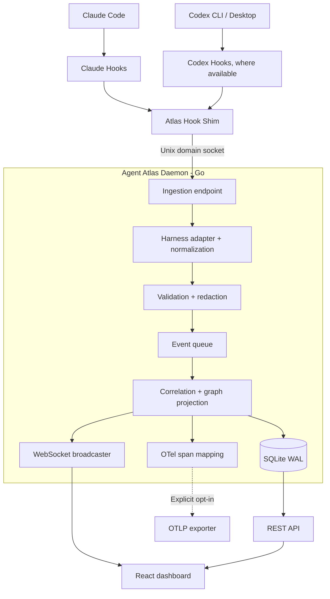
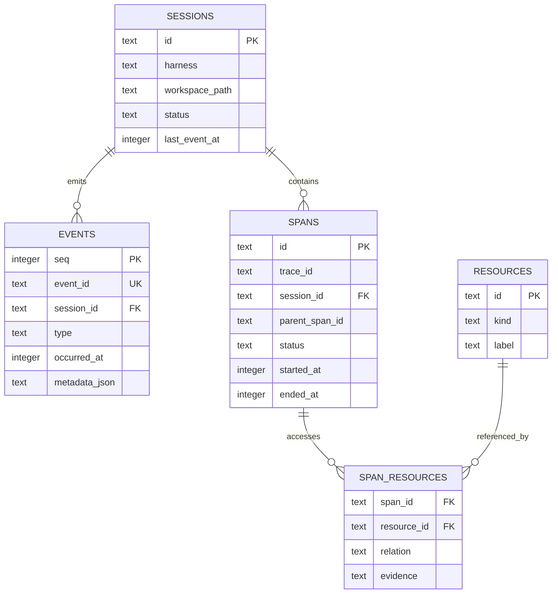

# Agent Atlas — Technical Design & MVP

- **Document version** v0.1
- **Status** Original design proposal. See the [readiness report](docs/readiness.md) for current implementation and verification results.
- **Last updated** 2026-11-23
- **Scope** Claude Code and Codex collection, a real-time Agent → Tool → File/MCP graph, and SQLite trace history, search, and replay.
- **Principles** Local-first, passive instrumentation, OpenTelemetry-compatible, evidence-aware, and private by default.

## 1. Executive Summary

**Agent Atlas** is a local-first observability application for AI coding agents. It captures supported execution events from Claude Code and Codex, normalizes them into a shared model, persists sanitized events and traces locally, and visualizes live activity and historical execution.

It answers:

- Which agents and sessions are active?
- Which tools are being invoked, and which calls are running, finished, failed, or unknown?
- Which files and MCP tools are involved, to the extent that instrumentation can actually observe them?
- What happened during a past session, and in what order?
- Which details were directly observed, and which are inferred?

**MVP excludes:** agent control/orchestration, deep subagent lineage, automated conflict detection, cloud synchronization, multi-host aggregation, cost accounting, packet capture, and access to private model reasoning.

> **Accuracy boundary:** Hook coverage is not comprehensive across all runtimes, commands, SDKs, or hosted tools. A shell command may access files or networks internally without those accesses being visible to the agent hook. Agent Atlas must never display inferred actions as verified observations.

## 2. Goals and Non-goals

### Goals

1. Collect compatible Claude Code and Codex events without changing project source code.
2. Use a harness adapter architecture so additional agents can be added later.
3. Present live sessions, tool invocations, and observed File/MCP resource relationships.
4. Provide SQLite-backed trace history, indexed filtering, and deterministic UI replay.
5. Keep telemetry on the local device unless the user explicitly enables external export.
6. Produce OpenTelemetry-compatible traces and stable internal event schemas.
7. Degrade safely when the daemon is unavailable; observability must not block agent work.

### Non-goals

- Intercepting hidden model reasoning, bypassing permissions, or reading arbitrary process memory.
- Capturing every file read or network request performed by programs spawned by a tool.
- Re-executing historical tool calls during replay.
- Replacing Jaeger, Langfuse, or Phoenix for full-scale hosted distributed tracing.
- Creating a new agent harness or modifying agent behavior.

## 3. Architecture Decision Record

| Concern | Decision | Rationale |
|---|---|---|
| Backend | Go daemon (`atlasd`) | Single-binary deployment, low overhead, concurrency |
| Hook integration | Lightweight `atlas hook` shim | Receives native hook payloads over stdin |
| Ingestion transport | Unix domain socket | Local IPC; no network listener required for collection |
| Storage | SQLite WAL, single writer | No external database, durable events, local history |
| Trace interoperability | OpenTelemetry-compatible spans and attributes | Future OTLP export without coupling MVP to a vendor |
| Dashboard | React + TypeScript | Rich UI and type-safe client |
| Graph visualization | React Flow / XYFlow | Custom nodes and edges, selection, pan/zoom |
| Layout | ELK.js | Layered graph and grouping support |
| History | Waterfall timeline + virtualized lists | Efficient browsing and trace inspection |
| Live delivery | WebSocket with resumable cursor | Low-latency updates and reconnect |
| macOS background service | launchd | Start and manage daemon locally |
| Export | Disabled by default | Minimize accidental data exposure |

### 3.1 Component diagram



### 3.2 Processing lifecycle

1. Agent triggers a supported native hook.
2. Hook invokes the local shim, passing JSON on stdin.
3. Shim bounds input size, attaches safe transport metadata, and sends it to the daemon through a Unix socket.
4. Daemon validates schema and normalizes harness-specific payloads.
5. Sanitization and allowlisting remove sensitive fields **before persistence, broadcast, or spooling**.
6. Correlation matches tool start/end events and creates or updates spans and resource edges.
7. Sanitized events are committed to SQLite, then published to clients with monotonic sequence cursors.
8. Dashboard updates live graph and allows opening a trace/timeline.

**Write-before-publish invariant:** committed storage sequence numbers are the canonical ordering for replay and resumption.

## 4. Integration Strategy: Claude Code and Codex

Implement compatibility through **capability-driven adapters**, not assumptions that all installed versions support identical hooks. Phase 0 must verify exact event names, payloads, runtime surfaces, configuration paths, and trust/approval behavior on the intended installed versions.

### 4.1 Adapter interface (illustrative Go)

```go
type Adapter interface {
    Name() string
    Normalize(raw []byte) ([]Event, error)
    Capabilities() Capabilities
}

type Capabilities struct {
    SessionLifecycle bool
    TurnLifecycle    bool
    ToolStart        bool
    ToolFinish       bool
    ToolFailure      bool
    Subagents        bool
    MCPCalls         bool
}
```

### 4.2 Capability matrix (verify per version)

| Signal | Claude Code | Codex | Atlas behavior |
|---|---|---|---|
| Session start/end | Via supported lifecycle hooks | Via supported lifecycle hooks/runtime interfaces | Start/close session when observed |
| Turn start | Via supported prompt/turn events | Via supported turn events if available | Group tool calls by turn where supported |
| Tool start | `PreToolUse` where configured | Tool hook/event where supported | Open span |
| Tool completion | `PostToolUse` where configured | Tool hook/event where supported | Close span |
| Tool failure | Explicit hook or returned status where available | Hook/result status where available | Mark failed only when evidenced |
| Subagents | Some lifecycle signals available | Depends on runtime/version | Deferred for deeper MVP+ lineage |
| MCP calls | Observed when passed through instrumented tool surface | Depends on hook coverage | Resource edge to MCP server/tool |
| Hosted/internal tools | Not guaranteed | Not guaranteed | Show coverage gaps explicitly |

**Codex Desktop note:** Do not equate Codex CLI support with Desktop support until validated in a compatibility spike. Some activity may require a distinct event source, or remain unavailable.

### 4.3 Hook installation UX (proposed commands)

```bash
atlas install-hooks --harness claude,codex
atlas doctor
atlas start
atlas open
atlas uninstall-hooks
```

These are proposed CLI commands, **not existing commands**.

Installer requirements:

- Discover installed harnesses and versions; show supported surfaces and coverage.
- Back up configuration before modifying it; merge Atlas entries rather than replacing unrelated hooks.
- Respect native trust and approval prompts.
- Make installation idempotent and reversible.
- Report differences between configured and actually observed signals.
- Never suppress permissions, approvals, or normal harness safety controls.

### 4.4 Shim reliability

- Hook shim must not modify agent output or decide approvals.
- Input size cap; parse/read timeout; nonzero error details stay out of agent-visible tool responses where possible.
- IPC send uses a short bounded timeout; caller can continue even if atlasd is unavailable.
- An optional bounded local spool can retain **already sanitized** events, protected by strict file permissions.
- Full spool produces `telemetry.gap`/drop counters; no unbounded storage growth.
- Session end, timeout, crash, or missing completion must not be mislabeled as tool failure.

## 5. Unified Event Contract

Events are normalized independently of harness-specific source formats. Preserve raw source fields only in memory during normalization; **raw prompts, responses, environment variables, and unbounded tool arguments are not stored by default**.

### 5.1 Example (sanitized metadata only)

```json
{
  "schema_version": 1,
  "event_id": "evt_01H_SAMPLE",
  "timestamp": "2026-11-23T10:15:00.123Z",
  "host_id": "local-mac",
  "harness": "codex",
  "session_id": "session_123",
  "turn_id": "turn_456",
  "tool_call_id": "call_789",
  "type": "tool.started",
  "tool": {
    "name": "Bash",
    "category": "shell",
    "operation": "execute"
  },
  "target": {
    "kind": "process",
    "label": "npm test"
  },
  "status": "running",
  "evidence": "observed",
  "privacy": "metadata_only"
}
```

### 5.2 Event types

| Event | Meaning |
|---|---|
| `session.started` | Observed session initialization |
| `turn.started` | Observed new interaction turn |
| `tool.started` | Tool invocation began |
| `tool.completed` | Tool returned successfully |
| `tool.failed` | Failure confirmed by available signal |
| `tool.denied` | Tool invocation denied, when observed |
| `session.ended` | Observed session termination |
| `telemetry.gap` | Missing/expired/dropped instrumentation events |

### 5.3 Status model

- `running`: start received and no terminal event yet.
- `completed`: terminal success received.
- `failed`: explicit failure signal received.
- `denied`: explicit permission denial received.
- `unknown`: terminal outcome cannot be established.
- `stale`: expected end missing after configurable threshold; **not synonymous with failure**.

### 5.4 Evidence model

- `observed`: source event directly supports claim.
- `derived`: deterministic transformation of directly observed fields (for example, duration).
- `inferred`: heuristic relationship (for example, parsed shell command suggests a file read).
- `unknown`: insufficient evidence.

Show evidence badges/tooltips in the Inspector. Do not silently turn inference into fact.

## 6. Trace Correlation and OpenTelemetry

### 6.1 Identity and grouping

- `event_id`: unique ingestion identifier, used for deduplication.
- `host_id + harness + session_id`: session identity (never assume global uniqueness of native session IDs).
- `turn_id`: group within session when supplied by source.
- `tool_call_id`: match invocation and completion when available.
- `trace_id`: W3C-style 128-bit trace ID.
- `span_id`: 64-bit ID.
- `parent_span_id`: only when parent relationship is grounded.
- `events.seq`: SQLite-assigned monotonic order for history and streaming.

**Never infer parent/child solely from timestamps.** If a source lacks credible parent IDs, record related entities rather than fabricated nesting.

### 6.2 Span examples

```text
Session: codex-123
└── Turn: 456
    ├── Tool: read_file
    │   └── File: src/auth.ts  [observed]
    ├── Tool: npm test
    │   └── Process: test runner  [observed]
    └── Tool: mcp__github__get_pr
        └── Service: GitHub MCP  [observed]
```

### 6.3 OTel design

- Translate normalized events into span lifecycle updates inside the daemon.
- Follow stable OTel SpanContext IDs and standard status semantics.
- Use GenAI semantic conventions when compatible, e.g. `gen_ai.operation.name`, `gen_ai.tool.name`.
- Use explicitly versioned custom attributes for product-specific data: `atlas.harness`, `atlas.session.id`, `atlas.tool.category`, `atlas.evidence`.
- Pin OTel SDK and semantic convention versions; record compatibility constraints.
- SQLite is authoritative. OTLP export is **optional, off by default**, and happens only after applying export-specific privacy controls.

## 7. SQLite Storage Design



### 7.1 Tables

| Table | Responsibility |
|---|---|
| `sessions` | Harness, workspace, lifecycle and last activity |
| `events` | Append-only sanitized event history with increasing sequence |
| `spans` | Materialized trace/span timing and outcomes |
| `resources` | File, MCP, process and other referenced resource metadata |
| `span_resources` | Links between spans and resources with relation/evidence |

### 7.2 Recommended schema details

- `events.seq INTEGER PRIMARY KEY AUTOINCREMENT` for a durable, non-reused replay cursor; `event_id TEXT UNIQUE NOT NULL`.
- Foreign keys from events and spans to sessions; create placeholder session when a start signal is missing.
- Unique index on `(host_id, harness, source_session_id)` where appropriate.
- Index events by `(session_id, seq)` and `(type, occurred_at)`; spans by `(trace_id, started_at)`; resources by `(kind, label)`.
- Store timestamps as UTC epoch microseconds or RFC3339 with a documented precision policy; do not mix formats.
- Large target labels should be bounded and privacy filtered.
- SQLite writes must be serialized through a writer queue and executed in transactions.

```sql
PRAGMA journal_mode = WAL;
PRAGMA foreign_keys = ON;
PRAGMA busy_timeout = 5000;
```

WAL allows concurrent readers with an active writer; it does **not** enable arbitrary concurrent writers.

### 7.3 Defaults (proposed)

| Setting | Default |
|---|---|
| macOS directory | `~/Library/Application Support/AgentAtlas/` |
| Data retention | 14 days |
| Max database size target | 1 GB |
| Sanitized spool cap | 32 MB |
| Raw prompts | Off |
| Raw tool output | Off |
| External telemetry export | Off |
| DB writer concurrency | 1 |

Retention should include pruning, WAL checkpoint management, disk monitoring, and explicit notifications of removals. An effective size cap requires backpressure and retention policies, not just a configuration value.

## 8. Live Graph UX

### 8.1 Layout

1. **Session sidebar:** active/idle/stale sessions grouped by harness and workspace.
2. **Graph canvas:** Agent/Session → Tool Invocation → File/MCP/Process resources.
3. **Inspector:** source event(s), status, duration, safe target label, evidence level, trace ID.
4. **Top controls:** pause live updates, filter by harness/workspace, search, open history.

### 8.2 Graph entities

| Entity | Example | Fields |
|---|---|---|
| Session | Claude Code / Codex | Harness, workspace, session state |
| Tool invocation | Bash / Read / apply_patch | Operation, timestamps, status, duration |
| File | `src/auth.ts` | Sanitized relative path, relation |
| MCP endpoint/tool | GitHub MCP | Server, tool name, observed status |
| Process | `npm test` | Safe command category/label, exit status when observed |

Edge relations: `invokes`, `reads`, `writes`, `connects_to`, `belongs_to`. Each resource edge has `evidence` and source span/event reference.

### 8.3 Rendering strategy

- Show recent activity in a default **60-second live window** plus all running invocations.
- Retain idle sessions but clearly distinguish them from active executions.
- Group repeated or high-volume file events; allow expand-on-demand.
- Use ELK.js to compute or incrementally update layout and React Flow to render.
- Batch frontend updates every ~100–250 ms as an initial optimization target.
- Virtualize large side lists; throttle layout recomputation and cap visible nodes.
- Allow drill-down into trace timeline rather than displaying all historical nodes permanently.

**Observability boundary:** A Bash invocation proves the agent invoked Bash. It does not prove everything done internally by the spawned process. Parsed command associations are `inferred` unless backed by a direct event.

## 9. History, Search, and Replay

History has two views:

- **Session list:** harness, workspace, start/end, duration, tool counts, errors and coverage caveats.
- **Trace explorer:** waterfall timeline, span tree, Inspector and linked resources.

### 9.1 Search filters

- Time range
- Harness
- Workspace/project
- Session ID
- Tool name/category
- Span status
- Observed resource label/path
- Evidence level

### 9.2 Replay contract

Replay reconstructs the view of stored events in original sequence. **No tool calls are executed and no source code is modified.**

- Store immutable `events.seq` to order display.
- Request a snapshot with its current cursor.
- Stream events after the cursor.
- On reconnect, request missed events; deduplicate by event ID/sequence.
- If the requested cursor has expired due to retention, return `resync_required` and reload the snapshot.
- Replay uses reducer/projector logic shared with the live view where possible.

### 9.3 Proposed API

```http
GET /api/v1/sessions?status=active
GET /api/v1/sessions/{id}/events?after_seq=100
GET /api/v1/traces/{traceId}
GET /api/v1/search?tool=Bash&status=failed
GET /api/v1/graph?session_id=abc
GET /api/v1/health
WS  /api/v1/stream?after_seq=1234
```

All endpoints are read-only except explicitly defined local settings/administration operations. Apply pagination and per-request limits to searches and graph queries.

## 10. Security and Privacy

### 10.1 Threat model

Potential risks: sensitive code or credentials in tool inputs/outputs, malicious hook payloads, local untrusted processes, browser access through localhost, persistent event history leaks, accidental OTLP export, and remote websites abusing local dashboard endpoints.

### 10.2 Security baseline

| Area | Design |
|---|---|
| IPC | Unix domain socket under user-owned directory, restrictive permissions |
| Network | Bind UI/API to loopback only by default |
| Authentication | Local session token, including WebSocket upgrade |
| Web security | Verify Origin/Host, CSRF protection on state-changing endpoints, restrictive CORS |
| Files | User-only directory `0700`; sensitive config/DB/spool `0600` where applicable |
| Ingestion | Schema validation, max payload, read/write timeouts, queue caps |
| Sensitive fields | Allowlist over denylist, bounded sanitized labels |
| Persistence | Redact **before** DB or offline spool |
| Export | Explicit opt-in, additional export policy and preview |
| Behavior | Passive hooks; no privilege escalation or auto-approval |
| Lifecycle | Pause collection, clear history, uninstall hooks, reversible config changes |

### 10.3 Redaction pipeline

```text
Native hook JSON
    ↓
Size and schema validation
    ↓
Field allowlist
    ↓
Secret/path/argument sanitization
    ↓
Safe resource extraction
    ↓
Sanitized event
    ├── SQLite
    ├── WebSocket
    └── Optional sanitized OTLP export
```

Default storage should prefer workspace-relative paths, hash or omit personal absolute paths when possible, and avoid unrestricted command lines, environment values, raw prompts, tool results and auth headers. Even metadata can be sensitive; show users what is being stored.

## 11. Repository Layout

```text
agent-atlas/
├── cmd/
│   ├── atlas/                 # CLI + hook shim
│   └── atlasd/                # Daemon
├── internal/
│   ├── adapters/
│   │   ├── claude/
│   │   └── codex/
│   ├── ingest/
│   ├── normalize/
│   ├── correlate/
│   ├── security/
│   ├── storage/sqlite/
│   ├── graph/
│   ├── telemetry/
│   └── api/
├── web/
│   └── src/
│       ├── features/
│       │   ├── live-graph/
│       │   ├── timeline/
│       │   ├── sessions/
│       │   └── inspector/
│       └── components/
├── migrations/
├── testdata/
│   ├── claude-hooks/
│   └── codex-hooks/
├── tests/
│   ├── integration/
│   └── e2e/
└── docs/
    ├── architecture.md
    ├── event-schema.md
    ├── security.md
    └── mvp-plan.md
```

## 12. Phased MVP Delivery

### Phase 0 — Compatibility Spike

**Tasks**

- [ ] Inspect installed Claude Code and Codex versions and native hook docs.
- [ ] Confirm supported hook events and actual JSON payloads in Claude Code.
- [ ] Confirm supported hook events and actual JSON payloads in Codex CLI.
- [ ] Separately confirm Codex Desktop hook support and trust/approval behavior.
- [ ] Capture **sanitized** test fixtures for start, success, failure, denied, missing completion, session lifecycle and MCP call.
- [ ] Measure shim startup and IPC overhead.
- [ ] Publish capability matrix and coverage gaps by harness/version.

**Exit:** Tool start/end correlation works on validated surfaces; unsupported surfaces are clearly documented. Design adjusts if Codex Desktop requires a separate source.

### Phase 1 — Collector, Correlator, SQLite

**Tasks**

- [ ] Build daemon and Unix IPC server.
- [ ] Build hook shim with failure-safe behavior.
- [ ] Implement Claude and Codex adapters.
- [ ] Implement allowlist/redaction before storage.
- [ ] Define versioned event contract and validation.
- [ ] Correlate tool spans; handle duplicates, missing completions and stale states.
- [ ] Create SQLite schema, migration runner, indexes and writer queue.
- [ ] Add session/events/trace REST APIs.
- [ ] Add ingestion tests, replay fixtures and crash/restart recovery tests.

**Exit:** Durable sanitized events, deduplication, recoverable trace history and no agent interruption when the daemon is down.

### Phase 2 — Live Graph

**Tasks**

- [ ] React/TypeScript app shell.
- [ ] Session list grouped by workspace/harness.
- [ ] React Flow graph with invocation/resource node types.
- [ ] Evidence-aware edges and Inspector.
- [ ] WebSocket feed with snapshot/cursor recovery.
- [ ] Node grouping, live window and layout throttling.
- [ ] Running/completed/failed/stale/unknown visual states.

**Exit:** Show simultaneous supported activity from Claude and Codex without manual refresh; every displayed resource link identifies its evidence source.

### Phase 3 — History, Security, Packaging

**Tasks**

- [ ] Waterfall timeline, trace details, filters and indexed searches.
- [ ] Deterministic read-only replay from stored events.
- [ ] Local auth/Origin checks, collection pause and history deletion.
- [ ] Retention and storage-size safeguards.
- [ ] Hook installer/uninstaller with safe merge/restore.
- [ ] launchd setup for macOS.
- [ ] Performance/security regression and E2E tests.
- [ ] Documentation and troubleshooting/doctor command.

**Exit:** Installable local-first MVP with the agreed Collector, Live Graph, and History scope.

## 13. MVP Acceptance Criteria

### Collector

- [ ] Real events received from Claude Code on the validated runtime.
- [ ] Real events received from Codex on the validated runtime(s); any unsupported surface explicitly disclosed.
- [ ] Tool start and terminal outcome paired without confusing concurrent tool calls.
- [ ] Missing end event produces `unknown` or `stale`, not fabricated failure.
- [ ] Agent workflow remains functional when the daemon is stopped.

### Live Graph

- [ ] Multiple agent sessions shown concurrently.
- [ ] Session → Tool → observed File/MCP resource links render accurately.
- [ ] Running, completed, failed, denied, stale and unknown status are distinguishable.
- [ ] Inspector shows event source and evidence quality.
- [ ] Reconnection restores state without duplicate nodes.

### History

- [ ] Restart preserves committed events and span history.
- [ ] Filter by harness, project, tool, status and time.
- [ ] Historical timeline renders concurrent spans correctly.
- [ ] Replay is deterministic and never re-executes agent operations.
- [ ] Cursor expiry gracefully triggers snapshot resync.

### Security

- [ ] No raw prompts or tool output persisted by default.
- [ ] Redaction occurs before spool/database/broadcast.
- [ ] No external telemetry export by default.
- [ ] UI/API/WebSocket enforce local access controls.
- [ ] Hook installation and removal preserve unrelated settings.

## 14. Non-functional Goals (Targets, not measured results)

| Metric | Initial target | Measurement |
|---|---|---|
| Hook overhead | p95 ≤ 50 ms | On-device benchmark of hook shim path |
| Collector-to-UI latency | p95 ≤ 500 ms | Timestamp at collector receipt vs browser update |
| Burst ingestion | 100 events/sec | Load test on reference Mac |
| Idle daemon + server RAM | < 150 MB | Process RSS; exclude browser process |
| Durability | Recover after daemon restart | Kill/restart integration test |
| Consistency | No silent gaps | Counters, `telemetry.gap` and replay assertions |
| Privacy | Zero raw secrets stored in default mode | Fixture-based redaction tests |

Targets should be revised after real benchmarks. Browser memory should be measured separately from daemon memory.

## 15. Risks and Mitigations

| Risk | Mitigation |
|---|---|
| Codex hook availability differs across runtime/version | Phase 0 compatibility verification, capability matrix and explicit gaps |
| Hook payload contains sensitive data | Allowlist, sanitization before persistence, bounded labels |
| Hook slows agent | Lightweight shim, short IPC timeout, non-blocking degradation |
| Agent crashes without completion event | `unknown`/`stale` state and telemetry gap reporting |
| Graph becomes unreadable | Live window, grouping, collapse and history drill-down |
| SQLite becomes large | Retention, size cap strategy, pruning and checkpoints |
| Reconnect loses updates | Commit-before-publish, sequence cursor and snapshot recovery |
| Untrusted local browser interaction | Auth token, Origin and Host validation, restrictive CORS |
| Inferred file access mistaken for fact | Evidence classification and traceable source events |

## 16. Recommended First Engineering Task

Implement **Phase 0: Compatibility Spike** first. Build a minimal harness-event capture prototype and verify exact events, trust behavior, and supported versions against real Claude Code and Codex installations. Only then lock the wire schema, hook templates, installer behavior, and supported-surface documentation.

The architectural foundation should remain: **native hooks → sanitized unified events → SQLite and trace projection → WebSocket → React Flow**, with OpenTelemetry compatibility and optional export.

## 17. References

These links are starting points for implementation; re-check them against installed versions during Phase 0.

- Claude Code hooks: https://code.claude.com/docs/en/hooks
- OpenTelemetry documentation: https://opentelemetry.io/docs/
- OpenTelemetry Go instrumentation: https://opentelemetry.io/docs/languages/go/instrumentation/
- OpenTelemetry generative AI semantic conventions: https://opentelemetry.io/docs/specs/semconv/gen-ai/
- React Flow: https://reactflow.dev/
- ELK.js: https://github.com/kieler/elkjs
- SQLite WAL: https://www.sqlite.org/wal.html
- Codex source/documentation: https://github.com/openai/codex

---

**Status:** Technical design for implementation planning. No compatibility claims or performance metrics in this document should be treated as validated until tested against actual installed harness versions.
